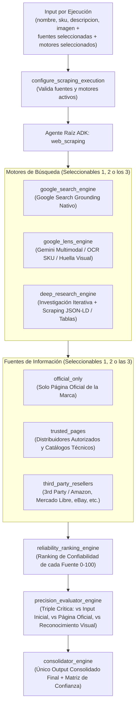

# Agente ADK `web_scraping` — Inteligencia y Verificación de Productos de Alta Precisión

Proyecto independiente de **Google Agent Development Kit (ADK)** (`google-adk`) 100% basado en **Gemini** diseñado para descubrir, extraer, evaluar y consolidar información de productos en la web a partir de:
- **Nombre del producto** (`nombre`)
- **SKU / MPN / EAN / UPC** (`sku`)
- **Descripción inicial** (`descripcion`)
- **Imagen del producto** (`imagen` — URL, ruta local, Base64 o adjunta directamente en el chat de ADK)

> **Prioridad Máxima**: Garantizar con precisión absoluta que el producto encontrado corresponda **exactamente** al producto buscado (mismo SKU, misma variante/generación, mismas especificaciones y coincidencia visual), descartando accesorios, variantes erróneas (`Pro`, `Plus`, `Lite`, `Gen 2`) o listados engañosos.

---

## Arquitectura Multi-Agente Modular



---

## Configuración Modular por Ejecución (en el Input)

En cada consulta al agente puedes elegir libremente qué **fuentes** y qué **motores** activar (por separado o combinados):

### 1. Opciones de Fuentes de Información (`fuentes`)
| Opción | Alias soportados | Descripción |
| :--- | :--- | :--- |
| `official_only` | `oficial`, `pagina_oficial`, `solo_pagina_oficial` | Busca y acepta únicamente páginas oficiales del fabricante/marca. |
| `trusted_pages` | `confiables`, `paginas_confiables`, `trusted` | Distribuidores autorizados, catálogos técnicos verificados (Icecat, BHPhoto, DigiKey, GS1, etc.). |
| `third_party_resellers` | `eth_party`, `3rd_party`, `resellers`, `terceros`, `marketplaces` | Marketplaces y resellers de terceros (Amazon, Mercado Libre, eBay, Walmart Marketplace, etc.). |

*Puedes enviar 1 sola opción (ej. `["official_only"]`), 2 opciones (ej. `["official_only", "trusted_pages"]`) o las 3 juntas (`["official_only", "trusted_pages", "third_party_resellers"]`).*

### 2. Opciones de Motores de Búsqueda (`motores`)
| Motor | Descripción |
| :--- | :--- |
| `google_search` | Búsqueda web mediante Google Search Grounding nativo de Gemini con directivas de dominio por tipo de fuente. |
| `google_lens` | Análisis visual tipo Google Lens con Gemini Multimodal: extrae OCR de etiquetas/empaque, identifica conectores/botones/color y compara fotos de páginas web contra la imagen de referencia. |
| `deep_research` | Sub-agente iterativo de investigación profunda que navega y extrae metadatos estructurados (`JSON-LD @type:Product`, `OpenGraph` y tablas HTML `<table>`/`<dl>`). |

---

## Estructura del Proyecto

```text
web-scraping-agent/
├── .env.example
├── pyproject.toml
├── README.md
├── web_scraping/
│   ├── __init__.py                        # Expone root_agent para `adk web` y `adk run`
│   ├── agent.py                           # Agente principal `web_scraping`
│   ├── config.py                          # Reglas modulares de fuentes, motores y dominios
│   ├── schemas.py                         # Esquemas Pydantic de entrada, ranking, crítica y output
│   ├── prompts.py                         # Instrucciones de alta precisión de los agentes
│   ├── tools/
│   │   ├── config_tools.py                # Configuración dinámica por ejecución
│   │   ├── vision_lens_tools.py           # Reconocimiento visual y comparación tipo Google Lens
│   │   ├── scraper_tools.py               # Extracción JSON-LD, OpenGraph y tablas técnicas
│   │   └── evaluation_tools.py            # Verificación de SKU exacto, ranking y triple evaluación
│   └── sub_agents/
│       ├── google_search_agent.py         # Motor Google Search Grounding
│       ├── google_lens_agent.py           # Motor Google Lens Multimodal
│       ├── deep_research_agent.py         # Motor Deep Research Iterativo
│       ├── reliability_ranking_agent.py   # Sub-agente de Ranking de Confiabilidad de Fuentes
│       ├── precision_evaluator_agent.py   # Agente Evaluador Crítico (Triple Validación)
│       └── consolidator_agent.py          # Sub-agente Consolidador del Output Final
└── tests/
    └── test_web_scraping_agent.py         # Pruebas unitarias de modularidad, ranking y evaluación
```

---

## Instalación y Uso

### 1. Instalar dependencias
```bash
cd ~/web-scraping-agent
python3 -m venv .venv
source .venv/bin/activate
pip install -e ".[dev]"
```

### 2. Configurar credenciales de Gemini
Copia `.env.example` a `.env` y agrega tu `GOOGLE_API_KEY` (o configuración de Vertex AI):
```bash
cp .env.example .env
```

### 3. Ejecutar con la interfaz gráfica de ADK (`adk web`) o CLI (`adk run`)
```bash
# Interfaz web interactiva (permite adjuntar imágenes directamente además de JSON/texto)
adk web .

# Ejecución por terminal
adk run web_scraping
```

---

## Ejemplos de Input por Ejecución

### Ejemplo A: Usando las 3 fuentes y los 3 motores
```json
{
  "nombre": "Sony WH-1000XM5",
  "sku": "WH1000XM5/B",
  "descripcion": "Audífonos inalámbricos over-ear con cancelación de ruido color negro, 30 horas de batería, carga USB-C",
  "imagen": "https://www.sony.com/image/wh1000xm5-black.jpg",
  "fuentes": ["official_only", "trusted_pages", "third_party_resellers"],
  "motores": ["google_search", "google_lens", "deep_research"],
  "dominios_oficiales": ["sony.com", "sony.com.mx"]
}
```

### Ejemplo B: Solo Página Oficial + Google Search y Deep Research
```json
{
  "nombre": "Logitech MX Master 3S",
  "sku": "910-006556",
  "descripcion": "Mouse inalámbrico ergonómico color grafito, sensor 8000 DPI, clicks silenciosos",
  "imagen": "",
  "fuentes": ["official_only"],
  "motores": ["google_search", "deep_research"],
  "dominios_oficiales": ["logitech.com"]
}
```

### Ejemplo C: Páginas Confiables + 3rd Party Resellers (Amazon / Mercado Libre) con Google Lens
```json
{
  "nombre": "Samsung Galaxy S24 Ultra 256GB Titanium Gray",
  "sku": "SM-S928BZTHEUB",
  "descripcion": "Smartphone 6.8 pulgadas Dynamic AMOLED 2X, S-Pen integrado, cámara 200MP",
  "imagen": "https://example.com/s24-ultra-box-label.jpg",
  "fuentes": ["trusted_pages", "eth_party"],
  "motores": ["google_lens", "google_search"]
}
```
